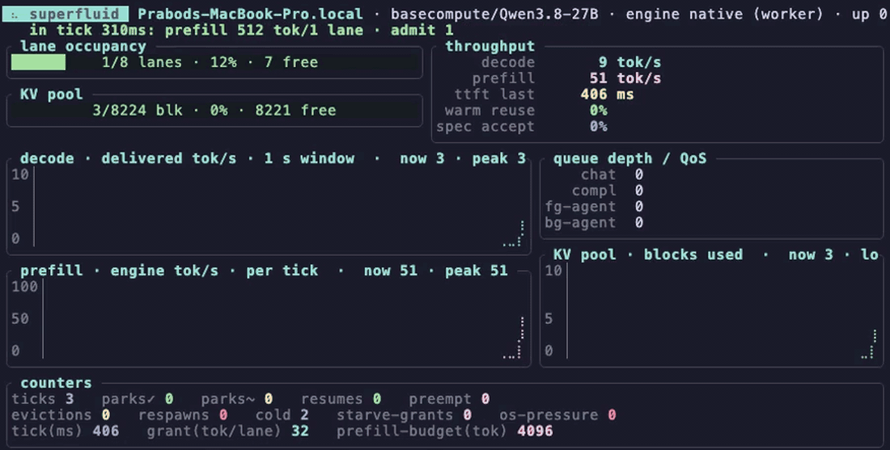
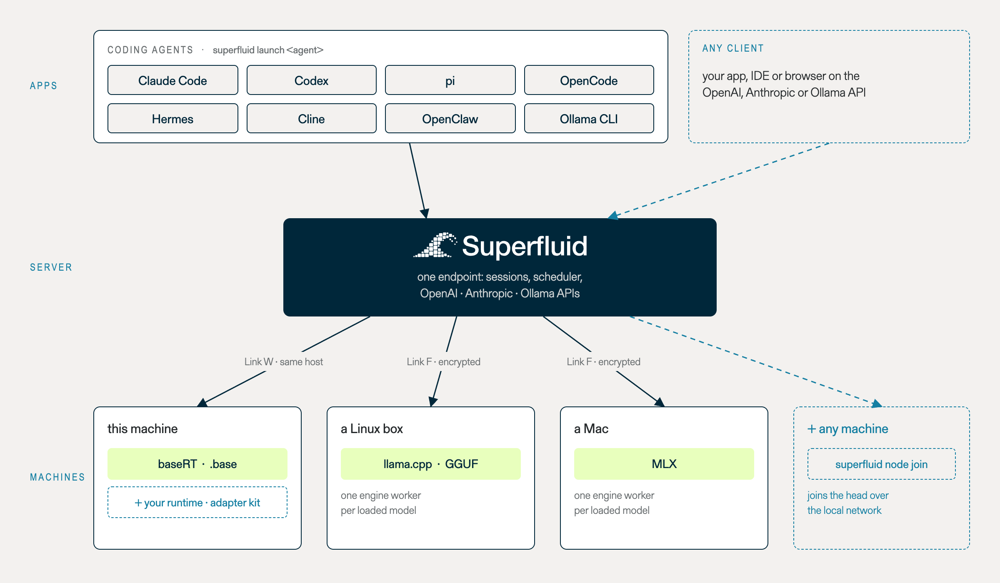

<p align="center">
  <picture>
    <source media="(prefers-color-scheme: dark)" srcset="docs/assets/logos/SF_logo.png">
    
  </picture>
</p>

<p align="center">
<b>Local AI server for distributed inference.</b>
</p>

<p align="center">
| <a href="https://docs.basecompute.co/latest/"><b>Documentation</b></a> | <a href="docs/getting_started/quickstart.md"><b>Quickstart</b></a> | <a href="docs/integrations/index.md"><b>Coding agents</b></a> | <a href="docs/performance/benchmarks.md"><b>Benchmarks</b></a> | <a href="https://discord.gg/kaYmAGckCq"><b>Discord</b></a> |
</p>

---

Superfluid is an open-source server that runs LLMs on your own hardware. It serves a model from one machine, or from several machines that act as one server.

A cluster of twelve Mac Studio M3 Ultras sustains over 10,000 tok/s of aggregate throughput. See [Reference deployments](#reference-deployments).

## What you can do with it

- **Build a private AI cluster.** Connect Macs, workstations and other local devices. Together they act as one inference server.
- **Use one endpoint for the whole cluster.** Superfluid exposes OpenAI, Anthropic and Ollama compatible APIs. Existing clients and coding agents work unchanged.
- **Run different runtimes.** BaseRT, llama.cpp and MLX are supported. Each machine uses the runtime that suits its hardware.

## Quickstart

### One machine

Install Superfluid and serve a model:

```sh
curl -fsSL https://basecompute.co/sf/install.sh | sh
superfluid serve basecompute/Qwen3.8-27B-BaseQuant-V1
```

The first run installs the BaseRT runtime, downloads the model and serves it at `http://127.0.0.1:8453`. BaseRT runs on Apple silicon, on Linux arm64 with an NVIDIA GPU and on Linux x86-64 with an AMD Strix Halo or Strix Point GPU.

You can also use llama.cpp or MLX. The model id picks the runtime: a GGUF repo such as `unsloth/Qwen3.8-27B-GGUF:UD-Q4_K_M` runs on llama.cpp, and an `mlx-community/...` repo runs on MLX (Apple silicon only).

Send a request:

```sh
curl http://127.0.0.1:8453/v1/chat/completions -H 'content-type: application/json' \
  -d '{"model":"basecompute/Qwen3.8-27B-BaseQuant-V1","messages":[{"role":"user","content":"hello"}]}'
```

Point a coding agent at the server. `launch` starts the server if none is running:

```sh
superfluid launch claude --model basecompute/Qwen3.8-27B-BaseQuant-V1
```

The same works for Pi:

```sh
superfluid launch pi --model basecompute/Qwen3.8-27B-BaseQuant-V1
```

Superfluid also supports Codex, OpenCode, Hermes Agent, Cline, OpenClaw and the Ollama CLI out of the box.

### A cluster

One machine is the head. It owns the endpoint and routes requests. The other machines join it as nodes and run the model.

On the head, create a token and start the server with a listener for nodes:

```sh
superfluid fleet token
superfluid serve basecompute/Qwen3.8-27B-BaseQuant-V1 --http 0.0.0.0:8453 --fleet-listen 0.0.0.0:8454
```

On each node, join with the token that the head printed:

```sh
superfluid node join --model basecompute/Qwen3.8-27B-BaseQuant-V1 --token <the token>
```

A node finds the head on the local network. To join a head on another network, pass its address: `superfluid node join <host:port> --model ...`. The head starts serving when the first node has joined. Clients use the head's endpoint on port 8453.

These commands bind the head to all network interfaces. Read [Security](docs/deployment/security.md) first.

<p align="center">
  
</p>
<p align="center"><sub>The terminal monitor of <code>superfluid serve</code> while eight agents read 7.5k-token documents on Qwen3.8-27B through BaseRT (Apple M5 Pro), at six times real time.</sub></p>

## What the server does

**On one machine**

- **Chat stays fast while agents run.** Interactive requests preempt agent and batch work instead of waiting behind it.
- **Sessions survive crashes.** Every token is written to a durable log before it reaches the client. A session continues after a worker crash or a server restart.
- **A shared prompt is computed once.** Requests that share a long system prompt reuse one prefill.
- **A runtime fault does not stop the server.** Each model runs in its own worker process. If a worker dies, it is restarted and serving continues.

**On a fleet of devices**

- **Mixed hardware.** Apple, AMD and NVIDIA machines serve the same model behind one endpoint.
- **Work follows speed.** Each machine reports its measured speed and load. Faster machines receive more sessions, with no per-machine configuration.
- **Machines can join and leave under load.** A new machine takes requests immediately. If a machine fails mid-response, another machine continues the stream from the tokens already delivered.
- **Encrypted links.** Only machines that hold the head's token can join. Traffic between machines is encrypted and authenticated.

## Reference deployments

### 1. Twelve Mac Studio M3 Ultras

Twelve Mac Studio M3 Ultras (512 GB each) serving Qwen3.6-35B-A3B on BaseRT. One of the twelve also acts as the head.

| Load | Throughput | Median first token |
|---|---|---|
| 384 concurrent streams, 2048-token prompts | **10,656 tok/s** aggregate (9,249 prompt and 1,407 output) | |
| 192 concurrent streams, 512-token prompts | 3,072 output tok/s (20 tok/s per stream) | 2.0 s |

Across six load points of 12 minutes each, the cluster served 38,563 requests without a failure.

### 2. Mixed hardware

Six machines of different types behind one endpoint, serving 64 simulated office users for one hour. Machines join one at a time, every 6 minutes. At 42 minutes one machine is killed mid-response and restarted 8 minutes later.

| | Run A | Run B |
|---|---|---|
| Machines | Apple M6, M4 Pro, M1 Max, AMD Ryzen AI Max 395, two NVIDIA GB10 | Apple M6, M4 Pro, M1 Max, M5 Pro, M3 Ultra, NVIDIA GB10 |
| Model and runtime | Qwen3-4B on llama.cpp | Qwen3.6-35B-A3B on BaseRT (Metal and CUDA) |
| Output tok/s, 1 machine to 6 | 112 to 534 | 104 to 476 |
| Median first token, 1 machine to 6 | 98.5 s to 11.7 s | 66.3 s to 6.9 s |
| Requests answered | 5,041 of 5,041 | 7,151 of 7,151 |

Requests in flight on the killed machine (61 in Run A, 52 in Run B) all completed. The head moved each stream to another machine, which continued from the tokens already delivered.

Faster machines served more without any per-machine configuration. In Run A the GB10s and the Ryzen AI Max each served 114 to 122 tok/s, against 71 to 73 tok/s for the M4 Pro and the M6.

## Benchmarks

**One machine.** Qwen3.8-27B at 4 bits on an Apple M5 Pro (64 GB), each Superfluid runtime against the servers for the same model format.

| | Superfluid (llama.cpp) | llama-server | Ollama | Superfluid (MLX) | mlx_lm.server |
|---|---|---|---|---|---|
| First token of a chat sent behind 8 busy agents | **1.47 s** | 291 s | 380 s | **2.01 s** | 612 s |
| Time to serve 32 requests that share one 4k-token prompt | **56 s** | 171 s | 88 s | **418 s** | 907 s |
| Serving again after the inference worker is killed | **1.75 s** | does not recover | 1.83 s | **1.85 s** | does not recover |

The serving layer adds no throughput cost. On Qwen3-4B (Apple M1 Max), Superfluid on llama.cpp matches llama-server at one request (76.7 against 76.8 tok/s) and is 4% ahead at eight (150.8 against 145.1 tok/s).

Method and full results: [Benchmarks](docs/performance/benchmarks.md).

## How it works

<p align="center">
  <picture>
    <source media="(prefers-color-scheme: dark)" srcset="docs/assets/diagrams/overview-dark.png">
    
  </picture>
</p>

Superfluid is written in Rust and runs as three kinds of process:

| Process | Role |
|---|---|
| Daemon | Owns the APIs, chat templates, tokenizers, scheduler and session log. In a cluster it is the head. |
| Worker | One per loaded model. Owns the weights, KV cache and sampling. |
| Node | Runs on another machine and serves the same model for the head. |

**The cluster replicates the model. It does not split it.** Every node holds a full copy of the model. The head places each session on one node, and only token ids cross the network. A slow machine receives less work, and a machine that leaves costs only its share of throughput.

**The model file picks the runtime.** Each runtime is installed on first use from its own project's releases. Nothing of llama.cpp, MLX or BaseRT is vendored or linked.

| Runtime | Serves | Comes from |
|---|---|---|
| `llamacpp` | GGUF files | llama.cpp's release builds |
| `mlx` | MLX model directories (Apple silicon) | a private CPython with `mlx-lm` |
| `basert` | `.base` bundles | [BaseRT](https://github.com/basecompute/baseRT)'s engine library |

Adding a runtime is one adapter crate. See [Writing a runtime adapter](docs/design/adapters.md).

## Security

The server binds to loopback and asks for no API key unless configured to. It does not speak TLS, so use it on loopback, on a trusted network or behind a reverse proxy. Nothing phones home. Read [Security](docs/deployment/security.md) before putting it on a network.

## Limitations

- Every node needs enough memory for a full copy of the model.
- A session that moves to another node recomputes its prompt. Nodes do not exchange KV caches.
- Nodes may run different quantisations of the model. In that case output depends on the node that serves the session.
- Images, audio and speculative decoding are served only by BaseRT.

> [!NOTE]
> Superfluid is pre-1.0. Flags, protocols and on-disk formats may change between releases.

## Documentation

Full docs are at [docs.basecompute.co](https://docs.basecompute.co/latest/).

- [Quickstart](docs/getting_started/quickstart.md)
- [OpenAI-compatible server](docs/serving/openai_compatible_server.md)
- [Coding agents](docs/integrations/index.md)
- [Distributed serving](docs/serving/distributed_serving.md)
- [Command-line reference](docs/serving/cli.md)

## Community

Ask questions and share projects on [Discord](https://discord.gg/kaYmAGckCq). Report bugs and request features on the [issue tracker](https://github.com/basecompute/superfluid/issues). Superfluid is built by [Base Compute](https://basecompute.co).

## Contributing

See [CONTRIBUTING.md](CONTRIBUTING.md) and [Development](docs/contributing/development.md). Report security issues through [SECURITY.md](SECURITY.md), not the issue tracker.

## Citation

```bibtex
@misc{superfluid2026,
  title  = {Superfluid: Local AI Server for Distributed LLM Inference},
  author = {Rathnayaka, Prabod and Manchanayake, Isura and Kogul, Srikandabala and Siu, Steve and Waschkowski, Fabian and Wesemann, Lukas},
  year   = {2026},
  note   = {Technical report, Base Compute}
}
```

## License

Apache-2.0. See [LICENSE](LICENSE) and [NOTICE](NOTICE). The BaseRT engine is a separate product under its own license. This repository contains only its openly licensed headers and loads the engine if it is installed.
