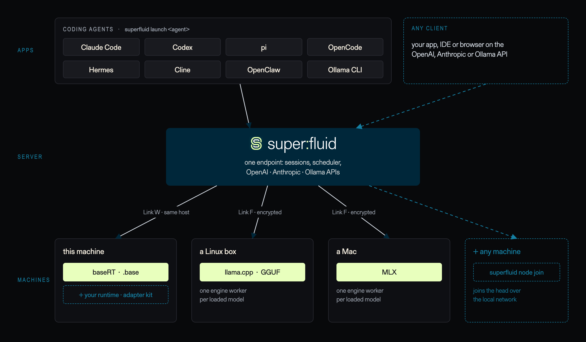

# Superfluid

**One serving daemon for local LLM inference — across runtimes and machines.**

Superfluid puts one scheduler, one durable session log and one set of APIs (OpenAI, Anthropic, Ollama) in front of llama.cpp, MLX and baseRT. Several agents share one machine without getting in each other's way, a session outlives a crashed worker or a restarted server, and existing clients work unchanged.

## Why Superfluid

- **A chat is answered while agents work.** An interactive request preempts batch work at the next scheduler tick instead of waiting behind it.
- **Nothing is lost when something dies.** Every committed token is in a write-ahead log; a killed worker or a restarted server picks its sessions up where they were.
- **A shared prompt is prefilled once.** Thirty-two requests with one 5k-token prefix cost one prefill, not thirty-two.
- **Your clients work unchanged.** OpenAI Chat Completions and Responses, Anthropic Messages, and Ollama, on one port.
- **More than one machine.** Other machines join the head over an encrypted link and serve the same API.

## Get started

- **[Installation](getting_started/installation.md)** — get `superfluid` on your `PATH`.
- **[Quickstart](getting_started/quickstart.md)** — serve a model and call it in under a minute.
- **[Coding agents](integrations/index.md)** — put Claude Code, Codex, OpenCode and others on a local model.
- **[Command-line reference](serving/cli.md)** — every command and flag.

## At a glance

```sh
# install
curl -fsSL https://basecompute.co/sf/install.sh | sh

# serve a model at http://127.0.0.1:8453
superfluid serve unsloth/Qwen3.8-27B-GGUF:UD-Q4_K_M

# put a coding agent on it
superfluid launch claude --model unsloth/Qwen3.8-27B-GGUF:UD-Q4_K_M

# add another machine to the same server
superfluid node join --model unsloth/Qwen3.8-27B-GGUF:UD-Q4_K_M --token <token>
```

## How it fits



The model file picks the runtime. Each runtime runs in its own worker process, installed on first use from its own project's releases:

| Runtime | Serves | Comes from |
| --- | --- | --- |
| `llamacpp` | GGUF files | llama.cpp's release builds |
| `mlx` | MLX model directories (Apple silicon) | a private CPython with `mlx-lm` |
| `basert` | `.base` bundles | [baseRT](https://github.com/basecompute/baseRT)'s engine library |

> [!NOTE]
> The server binds to loopback and asks for no key unless told to, and nothing phones home. Read [Security](deployment/security.md) before putting it on a network. Superfluid is pre-1.0: flags, protocols and on-disk formats may change between releases.

## Requirements

- macOS on Apple silicon, or Linux x86-64 / arm64 (glibc 2.28+). Other platforms build from source.
- Runtimes, models and the Hugging Face cache need disk space; nothing else is installed outside `~/.local` and `~/.superfluid`.
